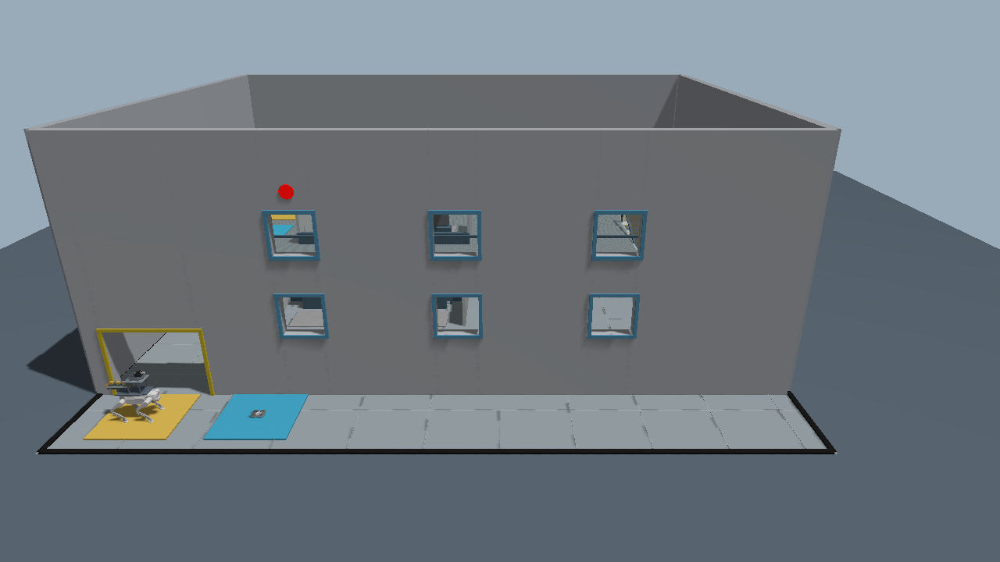

# D1 + Tello 组织方仿真与内部参考程序（ROS 2）

本目录仅供组织方使用，禁止作为选手包发放。选手包位于仓库 `contestant/`。启动默认为学生模式；下面完整参考演示需要显式指定 `mode:=demo scout_mode:=reference`。

包含 D1 EDU 机器狗、发射器、投放仓、无人机、两层地图和预训练步态。
比赛流程、场地、任务判定及信息使用要求统一见 [比赛规则](docs/COMPETITION_RULES.md)。
**无需训练、PyTorch 或 CUDA。** 源码、地图、模型与推理权重均在本包内，运行时不下载模型。



[查看地图俯视图：半幅二层、一层及右侧楼梯](docs/map_top.png) · [急救箱外观](docs/medical_kit_closeup.png)

默认采用新版 D1 外观：机身与头部来自智元官方 STEP，腿部沿用原网格并做平滑着色，颜色参考官方照片。仅更新显示几何，碰撞体、质量、惯量、关节与预训练策略保持不变；发射器和投放仓继续保留。该外观已完成平地行走、转向和连续八阶上楼验证。

[查看新版机器狗外观](docs/d1_official_appearance.png)。模型随包安装，无需额外下载或 CAD 工具；资源来源见 [THIRD_PARTY.md](THIRD_PARTY.md)。

## 1. 安装与编译

适用 **Ubuntu 22.04 + ROS 2 Humble + Gazebo Fortress（ign gazebo / Gazebo 6）**。
先按 [ROS 2 官方说明](https://docs.ros.org/en/humble/Installation/Ubuntu-Install-Debs.html) 安装 Humble，打开未加载 ROS 1 的终端：

```bash
source /opt/ros/humble/setup.bash
sudo apt update
sudo apt install build-essential cmake python3-colcon-common-extensions python3-numpy \
  ignition-fortress libignition-gazebo6-dev libeigen3-dev nlohmann-json3-dev \
  ros-humble-ament-cmake ros-humble-rclcpp ros-humble-rclpy \
  ros-humble-geometry-msgs ros-humble-nav-msgs ros-humble-sensor-msgs \
  ros-humble-rosgraph-msgs ros-humble-std-msgs ros-humble-std-srvs \
  ros-humble-launch-ros ros-humble-ament-index-python

mkdir -p ~/d1_ws/src
# 在拆分仓库根目录执行，仅复制组织方包
cp -a organizer/d1_tello_competition ~/d1_ws/src/
cd ~/d1_ws
colcon build --packages-select d1_tello_competition --cmake-args -DCMAKE_BUILD_TYPE=Release
source install/setup.bash
```

如果找不到 Fortress 安装包，按 [Gazebo 官方安装说明](https://gazebosim.org/docs/fortress/install_ubuntu/) 添加软件源后重试。
Humble 与 Fortress 的配套关系见 [官方兼容说明](https://gazebosim.org/docs/fortress/ros_installation/)。本包不适用于 Gazebo Classic 11 或直接替换为 Harmonic。

## 2. 一键演示

```bash
source ~/d1_ws/install/setup.bash
ros2 launch d1_tello_competition competition.launch.py mode:=demo scout_mode:=reference
```

自动播放完整比赛，约 5–7 分钟仿真时间，取决于随机任务布局。窗口中可拖动、缩放查看场景；Ctrl+C 退出。
调试时可指定着火窗（1–6），或用 `seed:=42` 复现随机场景：

```bash
ros2 launch d1_tello_competition competition.launch.py fire_window:=1
```

无窗口快速验收：

```bash
ros2 launch d1_tello_competition competition.launch.py \
  mode:=demo scout_mode:=reference gui:=false rate:=0 exit_on_finish:=true
```

每次启动都会打印独立结果目录，默认在 `~/.ros/d1_tello_competition/runs/`。
`result.json` 的 `strict_pass: true` 表示完整任务通过；同时保留运行日志和轨迹。
可用 `output:=/你选择的/新目录` 指定位置，该目录必须尚不存在。重新启动即重置比赛。

## 3. 学生控制接口

终端 1 启动学生模式，机器狗等待外部命令，无人机自动穿窗巡航。默认 `scout_mode:=external`，需要学生节点从无人机俯视图识别并报告任务。只练机器狗控制可使用 `scout_mode:=reference`，由教师模拟俯视传感器在到达目标上方后报告。

```bash
ros2 launch d1_tello_competition competition.launch.py mode:=student scout_mode:=reference
```

终端 2 加载工作空间，然后运行最小示例（前进、转向、停止）：

```bash
source ~/d1_ws/install/setup.bash
ros2 run d1_tello_competition student_walk.py --ros-args -p use_sim_time:=true
```

完整进门衔接示例：在**新启动的学生模式**中用下面程序替代 `student_walk.py`。
程序等待无人机穿窗和首报，然后转向、穿门，停在门内；后续任务由学生自行接入。

```bash
ros2 run d1_tello_competition student_enter.py --ros-args -p use_sim_time:=true
```

| 接口 | 类型 | 用途 |
| --- | --- | --- |
| `/d1/cmd_vel` | `geometry_msgs/msg/Twist` | 发布机身坐标速度：linear.x 前进、linear.y 左移、angular.z 左转 |
| `/d1/odom` | `nav_msgs/msg/Odometry` | 仿真真值位姿，world 坐标；速度为机身坐标 |
| `/d1/joint_states` | `sensor_msgs/msg/JointState` | 12 个关节的角度、速度、施加力矩 |
| `/clock` | `rosgraph_msgs/msg/Clock` | 仿真时钟，学生节点设置 use_sim_time:=true |
| `/d1/fire` | `std_srvs/srv/Trigger` | 申请发射动作 |
| `/d1/drop` | `std_srvs/srv/Trigger` | 申请投放动作 |
| `/competition/state` | `std_msgs/msg/String` | JSON 状态：目标、巡航报告、任务结果、事件等 |

速度建议 20–50 Hz 持续发布；超过 **0.4 秒仿真时间**收不到新命令会停止。
已验证范围：平地前进 ≤ 0.30 m/s、原地转向 ≤ 0.50 rad/s、上楼前进 ≤ 0.22 m/s。
建议先停稳再原地转向，上楼时沿楼梯中心正向前进。侧移、后退、下楼和更高台阶不在已验收范围。

```bash
# 持续前进；Ctrl+C 停止发布后由超时保护停下
ros2 topic pub -r 20 /d1/cmd_vel geometry_msgs/msg/Twist '{linear: {x: 0.2}}'

# 到达作业点并对准后调用；终端输出 success 仅表示受理
ros2 service call /d1/fire std_srvs/srv/Trigger '{}'
ros2 service call /d1/drop std_srvs/srv/Trigger '{}'
ros2 topic echo /competition/state
```

动作异步执行，通过 `/competition/state` 查询执行结果；受理条件和判定标准见[比赛规则](docs/COMPETITION_RULES.md#5-打靶投放与集合)。
状态 JSON 的 `entry` 给出门窗公开几何。`stations` 是六个位置的公开几何，`targets` 仅包含已经收到的无人机报告，`reported` 是按位置排列的六个报告标志；
`uav_entered`、`d1_entered` 表示机体已完全进入，`uav_phase` 表示无人机当前阶段。
`uav_exited` 是兼容旧版的离楼记录，`uav_landed` 为降落状态。

### 视觉报告接口与示例

`/uav/target_report` 接收 `std_msgs/msg/String` JSON，例如 `{"slot": 3, "marker_color": "green"}`。`slot` 为 0–5，颜色为 `red`、`green` 或 `gray`。
`/uav/odom` 提供无人机世界位姿，`/competition/uav/image` 提供俯视 RGB；参考颜色节点读取这两个接口及公开几何。

视觉报告示例，终端 1：

```bash
ros2 launch d1_tello_competition competition.launch.py mode:=student cameras:=true camera_views:=uav seed:=42
```

终端 2：

```bash
ros2 run d1_tello_competition uav_color_report.py --ros-args -p use_sim_time:=true
```

终端 3 可运行 `student_enter.py` 或自己的机器狗控制器。颜色示例仅在无人机稳定飞到标识正上方时分类，适用于此课程固定地图，非通用视觉定位算法。随机窗号已实现，但无人机穿窗导航目前仍由教师控制器依据裁判配置执行；尚未实现自主着火窗视觉导航。

## 4. 可选相机与修改入口

```bash
ros2 launch d1_tello_competition competition.launch.py mode:=student cameras:=true
```

启用 `/competition/{overview,dog,uav,fpv,uav_front,entry}/image` 六路 ROS 2 图像，分别为总览、跟拍、无人机俯视、机器狗前视、无人机前视、楼外入口观察，默认 20 Hz。
可用 `camera_views:=entry,uav_front` 只开所需视角，`camera_fps:=30` 设置相机目标采样帧率。
需要可用的图形环境与驱动；图形较慢时关闭相机，或 `gui:=false cameras:=false` 只运行物理仿真。
切勿同时启动两个同域仿真实例；多组同机实验可分别设置不同的 `ROS_DOMAIN_ID` 和 `IGN_PARTITION`。

- 学生算法入口：`examples/student_walk.py` 和 `examples/student_enter.py`，可自行新建 ROS 2 节点接入上述接口。
- 起点与集合参数：`config/mission.json`；随机任务及对应演示路线：`scripts/scenario.py`；入口参数：`config/entry.json`，立面与进出航点由 `scripts/entry_scene.py` 同步构建；基础地图：`worlds/competition.sdf.in`。
- 步态已冻结：`policy/actor.bin`，50 Hz 推理、1000 Hz 关节 PD；修改地图高度时须同步 `config/terrain.json` 的高度观测。
- 修改源码或资源后重新 `colcon build`，再加载 `install/setup.bash`；构建和安装目录不需手工编辑。

教学边界：载荷装置只保留外观，不增加机身质量、惯量和碰撞；发射后的球与投放后的物资有独立物理动力学。
步态使用仿真状态和已知地图高度；无人机飞行使用预设航点与力控制，不含 PX4 或 SLAM。`reference` 报告使用受位置约束的模拟俯视传感器；`external` 报告由学生节点提供，附带一个简单 RGB 颜色识别示例。
红圆与所选窗户由场景配置关联，演示不声称从图像自主识别着火窗；新增前视图可供学生实现识别。

无人机在分发版采用基础几何体外观，动力学保留。来源与许可见 [THIRD_PARTY.md](THIRD_PARTY.md)。
本次布局与路线的验收见 [地图调整验收](docs/MAP_VALIDATION.md)。旧版穿窗返航流程的历史记录见 [v1.2 入楼验收](docs/ENTRY_VALIDATION.md)。
